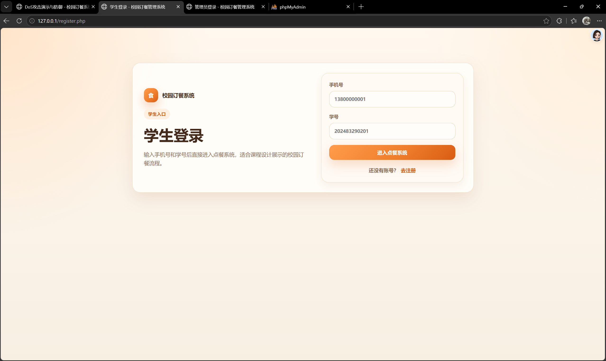
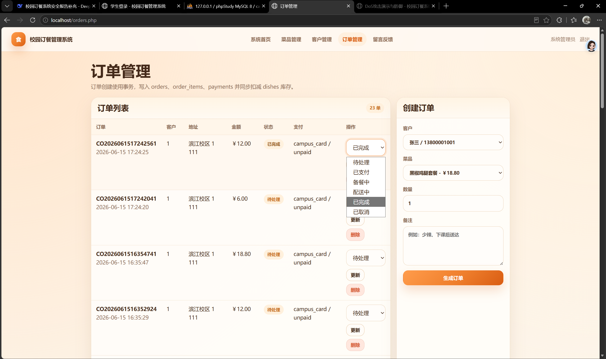
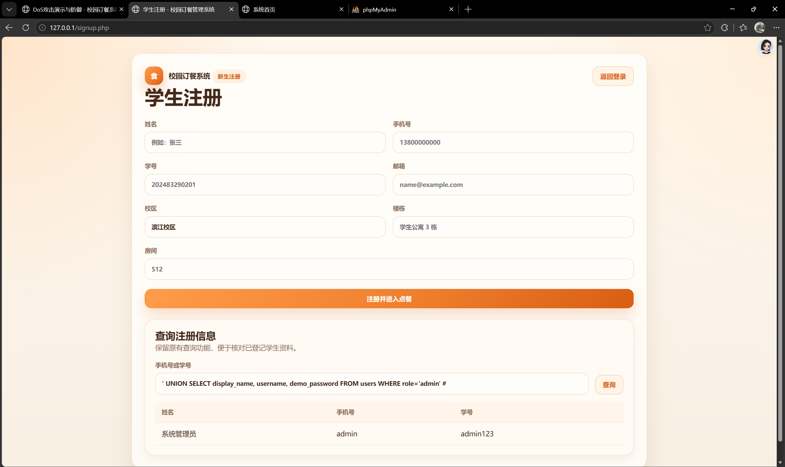
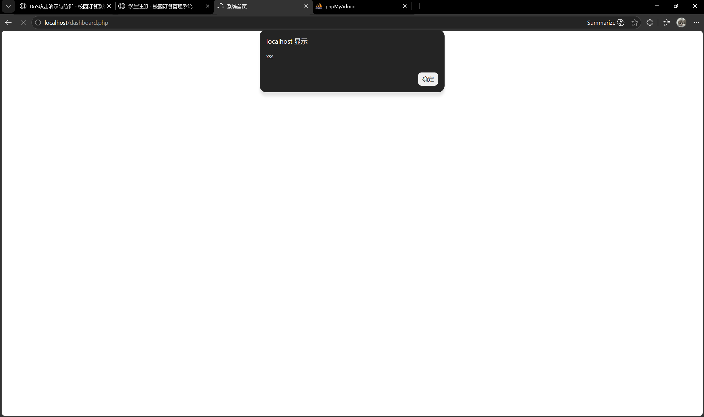
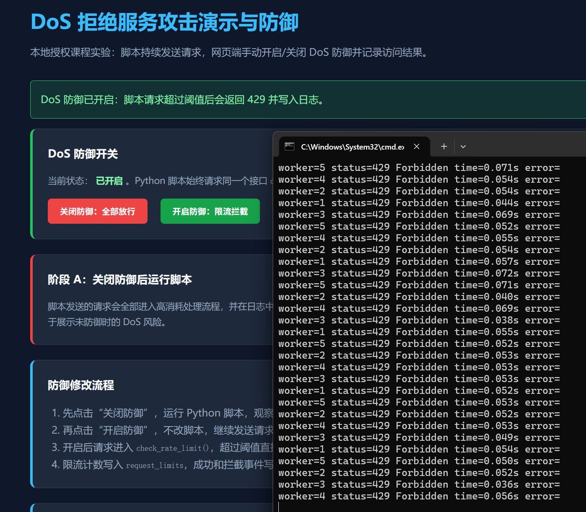

# 校园订餐管理系统 · Web 安全攻防实验

> ⚠️ **本项目为课程设计教学环境，代码中故意保留了 SQL 注入点与存储型 XSS 点，用于演示「攻击 → 防御 → 复测」的对比实验。**
> **请勿部署到公网，请勿用于任何未授权目标。** 所有实验仅限本地环境。

## 项目简介

以「校园订餐」为业务场景，完成一个 PHP + MySQL 的 Web 信息管理系统，并在此基础上开展三类典型 Web 安全实验：

| 实验 | 攻击入口 | 防御手段 | 复测结果 |
| --- | --- | --- | --- |
| SQL 注入 | 学生注册页的「注册信息查询」 | PDO 预处理参数绑定 | Payload 被当作普通字符串，无法改变 SQL 结构 |
| 存储型 XSS | 点餐页的订单留言 → 后台留言展示 | `htmlspecialchars()` 输出编码 + CSP | Payload 以文本显示，脚本不再执行 |
| DoS 拒绝服务 | 本地请求脚本持续访问计数接口 | 固定窗口限流 + 429 拦截 + 事件落库 | 超过阈值返回 429，拦截记录写入数据库 |

每个实验都按 **攻击入口 → Payload → 攻击结果 → 修复代码 → 复测结果** 的闭环执行，并保留截图与数据库记录作为证据。

## 功能概览

**学生端**

- 手机号 + 学号登录，首次使用可注册
- 浏览菜品分类与菜品，提交订单
- 填写配送地址、订单留言
- 查看最近订单

**管理员端（`/admin`）**

- 后台登录、首页统计（订单 / 菜品 / 学生 / 留言）
- 菜品管理：新增、查询、修改、删除，关联分类
- 客户管理：新增、查询、修改、删除，新增时同步创建默认地址
- 订单管理：创建、修改状态、删除
- 留言管理：查看、删除

**下单事务**：一次下单同时写入 `orders`、`order_items`、`payments` 并扣减 `dishes.stock`，全部成功才提交，任一失败回滚。

## 实验截图

**学生登录页**



**后台订单管理**（下单事务写入订单、明细、支付并扣减库存）



**SQL 注入结果**：查询框内为 Payload，结果表格返回了 `users` 表的管理员字段



**存储型 XSS 触发**：管理员打开后台页面时脚本执行



**DoS 限流拦截**：开启防御后，超过阈值的请求返回 429



## 技术栈

- 语言：PHP（`declare(strict_types=1)`）、HTML、CSS、Python（仅 DoS 压测脚本）
- 数据库：MySQL 8，PDO 访问
- 环境：phpStudy（Apache/Nginx + MySQL）
- 安全：PDO 预处理、输出编码、CSRF Token、Session 重置、CSP、请求限流、安全事件记录

## 目录结构

```
campus-order-security/
├── admin/index.php          # 管理员登录入口
├── assets/style.css         # 页面样式
├── config/config.php        # 数据库与限流配置（支持环境变量覆盖）
├── database/schema.sql      # 11 张表结构 + 示例数据
├── docs/                    # 实验报告、数据库设计、部署说明
├── includes/                # db / auth / helpers / header / footer
├── screenshots/             # 实验截图
├── customers.php            # 客户管理
├── dashboard.php            # 后台首页
├── dishes.php               # 菜品管理
├── orders.php               # 订单管理
├── feedback.php             # 留言管理
├── menu.php                 # 学生点餐（含下单事务）
├── register.php             # 学生登录
├── signup.php               # 学生注册（含故意保留的注入点）
├── setup.php                # 数据库初始化
└── dos_demo.php             # DoS 演示与限流防守页面
```

## 快速开始

1. 把整个项目目录放到 phpStudy 的网站根目录（如 `WWW/campus_order_security`）。
2. 启动 Apache/Nginx 与 MySQL。
3. 浏览器访问 `http://localhost/campus_order_security/setup.php`，点击「创建数据库并导入示例数据」。
4. 访问管理员入口 `http://localhost/campus_order_security/admin/`。

默认管理员账号（仅本地演示）：

- 用户名：`admin`
- 密码：`admin123`

> 数据库默认连接 `127.0.0.1:3307`，账号 `root/root`。若你的 MySQL 在 3306，请修改 `config/config.php` 或设置环境变量 `DB_PORT=3306`。

## 数据库设计

共 11 张表，前 9 张承担业务，后 2 张承担安全实验支撑。

| 表 | 用途 | 关键关系 |
| --- | --- | --- |
| `users` | 后台账号 | `orders.user_id` 关联 |
| `customers` | 学生客户 | 地址、订单、留言关联 |
| `categories` | 菜品分类 | `dishes.category_id` |
| `dishes` | 菜品 | `order_items.dish_id` |
| `addresses` | 配送地址 | `orders.address_id` |
| `orders` | 订单主表 | 关联客户、地址、处理人 |
| `order_items` | 订单明细 | 拆解订单与菜品多对多 |
| `payments` | 支付记录 | `order_id` 唯一 |
| `comments` | 留言 | 关联客户与菜品 |
| `request_limits` | 请求频率窗口 | 唯一键 `(client_key, window_start)` |
| `security_events` | 安全事件日志 | 记录类型、等级、Payload、防御动作 |

详细设计说明见 [docs/database-design.md](docs/database-design.md)。

## 安全设计（正向）

- 管理员密码 `password_hash()` 存储，登录用 `password_verify()` 校验
- 登录成功后 `session_regenerate_id(true)`，降低会话固定风险
- 全部 POST 表单校验 CSRF Token（`random_bytes` + `hash_equals`）
- 统一输出转义函数 `e()`（`htmlspecialchars` + `ENT_QUOTES`）
- 后台响应设置 `Content-Security-Policy`
- 限流使用数据库唯一键 + `ON DUPLICATE KEY UPDATE` 做固定窗口计数
- 拦截与放行事件写入 `security_events`，便于审计

## 刻意保留的风险点（教学用途）

以下两处是**故意保留**的，用于对比实验，其他位置均按规范实现：

| 位置 | 文件 | 问题 | 说明 |
| --- | --- | --- | --- |
| 注册信息查询 | `signup.php` | 字符串拼接 SQL | 演示 SQL 注入，修复方案见实验报告 |
| 后台留言展示 | `dashboard.php`、`feedback.php` | 未转义输出原始留言 | 演示存储型 XSS |

**这样设计的目的**：制造一个「修复前 / 修复后」的受控对比环境，而不是写不安全代码。请勿在真实项目中使用这种写法。

## 已知限制

- DoS 实验为本地低强度模拟，限流基于数据库计数，未使用 Redis，不适合高并发场景
- 学生端采用手机号 + 学号登录，未设置独立密码，仅适合演示
- 未实现文件上传、支付对接、HTTPS 部署等生产级功能
- 示例数据中的 `demo_password` 字段仅用于演示注入效果，已在文档中标注

## 文档

- [安全实验报告](docs/security-lab.md)：三类漏洞的攻击、防御与复测全过程
- [数据库设计说明](docs/database-design.md)：表结构、关系、范式与事务分析
- [部署说明](docs/setup.md)：从零搭建本地实验环境

## 免责声明

本项目仅用于课程设计与本地授权环境下的安全学习。任何未经授权的测试行为均属违法，与项目作者无关。
