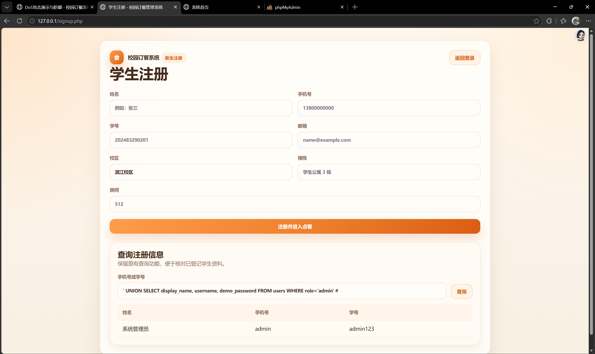
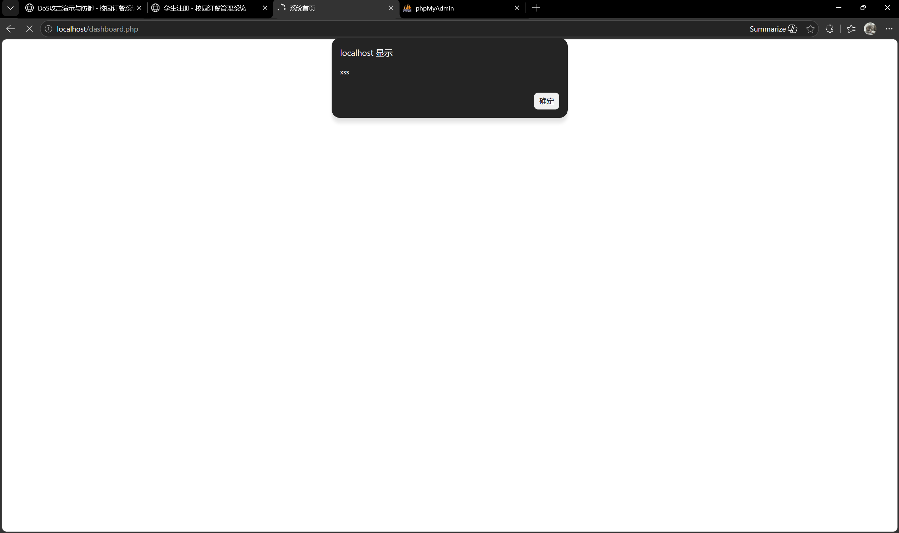
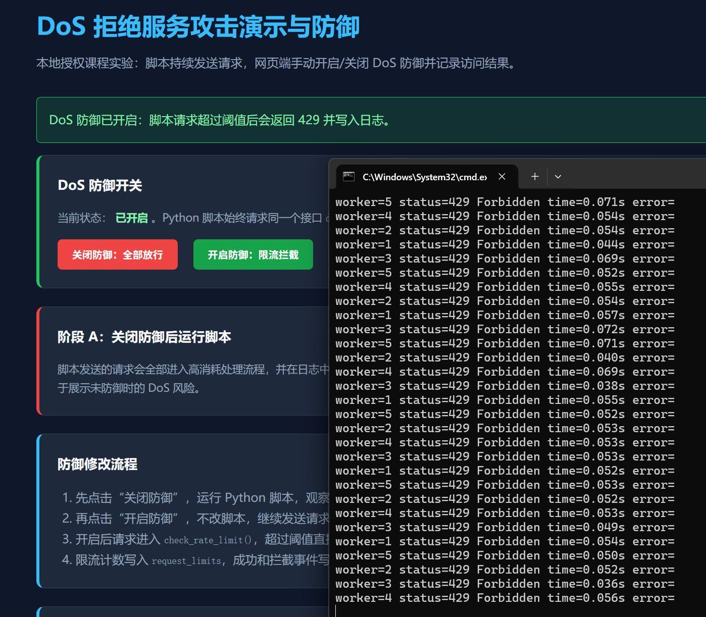

# Web 安全实验报告

> 实验对象：本仓库的校园订餐管理系统
> 实验环境：Windows 本地 + phpStudy + MySQL 8，全程仅访问本机 `localhost`
> 实验目的：验证三类典型 Web 风险的成因、影响与修复效果

## 1. 实验目标

本次实验不追求「攻破系统」，而是完成一个受控对比：

1. 在**故意保留缺陷**的位置验证风险是否真实存在
2. 用标准方案修复
3. 用同一个 Payload 复测，证明风险已消除
4. 记录攻击与拦截事件，说明可审计性

## 2. SQL 注入实验

### 2.1 攻击入口

学生注册页 `signup.php` 的「查询注册信息」功能，接收手机号或学号作为 `keyword`。

未修复的查询逻辑（字符串拼接）：

```php
$keyword = trim($_POST['keyword'] ?? '');
$sql = "SELECT name, phone, student_no FROM customers WHERE phone = '{$keyword}' OR student_no = '{$keyword}'";
$checkRows = $pdo->query($sql)->fetchAll();
```

### 2.2 攻击 Payload

```
' UNION SELECT display_name, username, demo_password FROM users WHERE role='admin' #
```

### 2.3 攻击流程与结果

| 步骤 | 操作 | 观察结果 |
| --- | --- | --- |
| 1 | 输入正常手机号查询 | 只返回对应学生记录 |
| 2 | 输入 UNION SELECT Payload | 查询结果被拼入管理员账号信息 |
| 3 | 截图留证 | 页面表格中出现管理员用户名与口令字段 |

**成因**：用户输入直接进入 SQL 语句，数据库把 `UNION`、`#` 当作语法而不是数据。

**影响**：可越权读取其他表的数据（本例读取了 `users` 表），进一步可导致敏感信息泄露。



### 2.4 修复代码

改为 PDO 预处理，输入只作为参数绑定：

```php
$stmt = $pdo->prepare('SELECT name, phone, student_no FROM customers WHERE phone = ? OR student_no = ?');
$stmt->execute([$keyword, $keyword]);
$checkRows = $stmt->fetchAll();
```

### 2.5 复测结果

使用完全相同的 Payload 再次查询：

- 页面把整串内容当成手机号/学号的字面值去匹配
- 返回结果为空，不再出现管理员信息
- 数据库未执行 UNION 部分

## 3. 存储型 XSS 实验

### 3.1 攻击入口

- 写入点：学生点餐页 `menu.php` 的「订单留言」
- 触发点：管理员后台 `dashboard.php`、`feedback.php` 的留言展示区

留言写入时同时保存两份：

```php
$comment = $pdo->prepare('INSERT INTO comments (customer_id, dish_id, content, safe_content) VALUES (?, ?, ?, ?)');
$comment->execute([$student['id'], $firstDishId, $remark, e($remark)]);
```

- `content`：原始内容（用于演示风险）
- `safe_content`：转义后内容（安全版本）

后台未修复时直接输出原始内容：

```php
<?php echo $comment['content']; ?>
```

### 3.2 攻击 Payload

```html
<script>alert('xss')</script>
```

### 3.3 攻击流程与结果

| 步骤 | 操作 | 观察结果 |
| --- | --- | --- |
| 1 | 在留言框提交 Payload | 内容写入 `comments.content` |
| 2 | 管理员打开后台首页 | 浏览器弹窗执行 |
| 3 | 截图留证 | 弹窗与页面异常截图 |

**类型**：存储型 XSS。恶意内容先落库，再由管理员浏览器读取执行。

**影响**：可冒充管理员执行操作、读取会话 Cookie、篡改后台展示内容。



### 3.4 修复代码

统一走输出转义函数（`includes/helpers.php`）：

```php
function e(?string $value): string
{
    return htmlspecialchars((string) $value, ENT_QUOTES | ENT_SUBSTITUTE, 'UTF-8');
}
```

后台输出改为：

```php
<td><?= e($comment['content'] ?? '') ?></td>
```

辅助加固：后台响应添加 CSP

```php
header("Content-Security-Policy: default-src 'self'; script-src 'self'; style-src 'self' 'unsafe-inline'; img-src 'self' data:; frame-src 'self'; base-uri 'self'; form-action 'self'");
```

### 3.5 复测结果

继续提交相同 Payload：

- 页面以纯文本形式显示 `<script>...`，不产生弹窗
- CSP 进一步阻止内联脚本执行
- 说明：CSP 是纵深防御，不能替代输出编码

## 4. DoS 本地模拟与限流防御

### 4.1 实验边界

- 压测脚本 `dos_local_test.py` 内置白名单，**只允许 `localhost`、`127.0.0.1`、`::1`**
- 仅做本地低强度模拟，不对任何外部服务发起请求
- 防御开关由网页按钮控制，脚本只负责发请求

### 4.2 攻击端

```powershell
python .\dos_local_test.py --manual --concurrency 5 --interval 0.1
```

输入 `start` 开始，`stop` 停止并输出统计。

未开启防御时，终端持续显示 `status=200 OK`，所有请求都进入业务处理流程。

### 4.3 防御实现

固定窗口计数，借助数据库唯一键实现原子累加：

```php
function check_rate_limit(string $clientKey, int $maxRequests = 5, int $windowSeconds = 10): bool
{
    $windowStart = (int) (floor(time() / $windowSeconds) * $windowSeconds);
    $stmt = db()->prepare('INSERT INTO request_limits (client_key, window_start, request_count) VALUES (?, ?, 1) ON DUPLICATE KEY UPDATE request_count = request_count + 1');
    $stmt->execute([$clientKey, $windowStart]);
    $stmt = db()->prepare('SELECT request_count FROM request_limits WHERE client_key = ? AND window_start = ?');
    $stmt->execute([$clientKey, $windowStart]);
    return (int) $stmt->fetchColumn() <= $maxRequests;
}
```

超限直接返回 429，并记录事件：

```php
if (!check_rate_limit($key, 5, 10)) {
    log_security_event('dos', 'high', '防御开启，返回 429', '固定窗口限流拦截');
    json_response(['status' => 'blocked', 'message' => '超过阈值，返回 429'], 429);
}
```

### 4.4 复测结果

- 开启防御后，不修改压测脚本，继续请求同一接口
- 前若干次返回 200，超过阈值后返回 `429 Forbidden`
- `request_limits` 表可看到当前窗口的请求计数
- `security_events` 表记录了放行与拦截事件



### 4.5 方案局限

| 项目 | 说明 |
| --- | --- |
| 存储 | 用数据库计数，未使用 Redis，高频写入会成为瓶颈 |
| 窗口算法 | 固定窗口存在边界突刺问题，生产环境建议滑动窗口或令牌桶 |
| 防护层级 | 生产环境还应叠加 Nginx `limit_req`、WAF、CDN 清洗、连接数限制 |

## 5. 三类实验结果汇总

| 攻击类型 | 攻击方式 | 防御方式 | 复测结论 |
| --- | --- | --- | --- |
| SQL 注入 | UNION SELECT 改变查询结构 | PDO `prepare()` + 参数绑定 | Payload 退化为普通字符串，查询结构不变 |
| 存储型 XSS | 留言写入 `<script>` / `onerror` | `htmlspecialchars()` 输出编码 + CSP | 脚本以文本显示，不执行 |
| DoS | 脚本持续请求本地计数接口 | 固定窗口限流 + 429 + 事件落库 | 超阈值被拦截并可审计 |

## 6. 结论

三类风险的共同根源都是「对输入和请求频率的过度信任」：

1. 数据进入 SQL 前必须参数化，让数据与语句分离
2. 数据输出到 HTML 前必须按上下文编码
3. 服务端必须对请求频率设限，并保留可审计记录

安全不是某一个功能点，而是贯穿设计、编码、测试与运维的过程。
